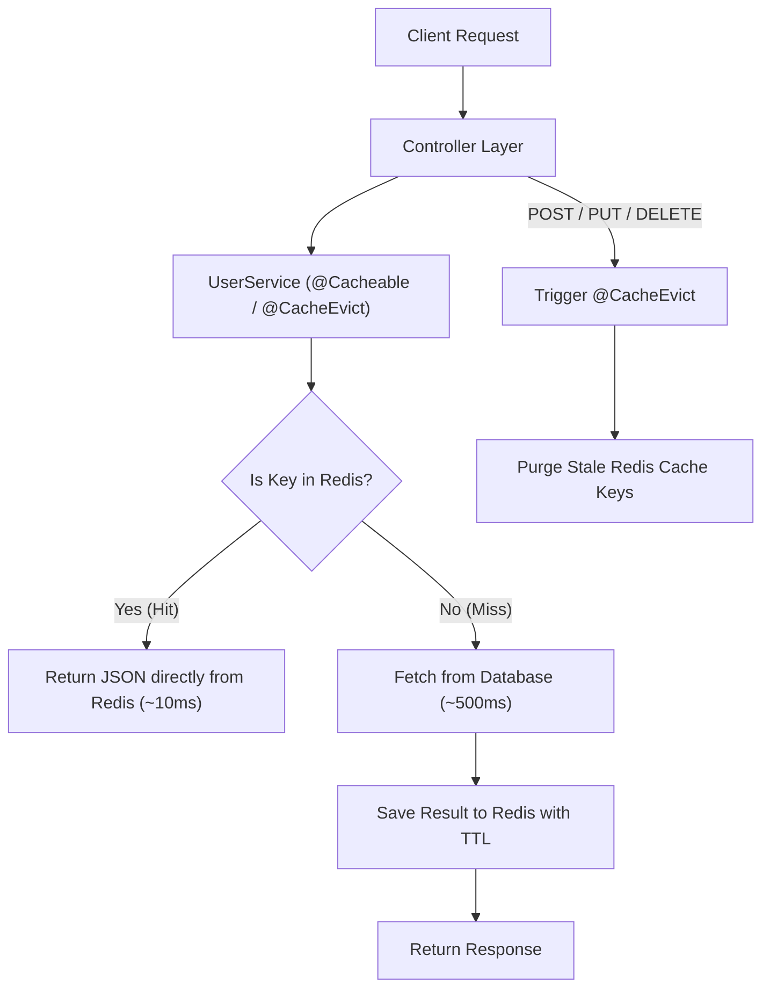

# 🚀 Spring Boot Redis Caching & Performance Optimization API

A high-performance RESTful API built with **Java 21** and **Spring Boot 3** demonstrating Redis caching integration, TTL expiration strategies, cache invalidation on write/update/delete operations, and measurable performance bench-marking.

---

## 📌 Features & Architecture Overview

* **Embedded Redis Server**: Self-contained Redis in-memory server integration for zero-setup execution.
* **Spring Cache Abstraction**: `@Cacheable`, `@CachePut`, and `@CacheEvict` annotations for clean code separation.
* **Time-To-Live (TTL) Expiration**: Granular expiration rules per cache region (e.g. 30 seconds for list cache, 5 minutes for single-entity lookup).
* **JSON Serialization**: Configured `GenericJackson2JsonRedisSerializer` for human-readable cached entries in Redis.
* **Cache Invalidation Strategies**: automatic eviction upon creating, updating, or deleting user records to ensure strong consistency without stale reads.
* **Performance Metrics**: Direct execution time metadata (`executionTimeMs`) returned in API responses to measure response latency before and after caching.

---

## ⚡ Performance Benchmark Results

The API simulates standard database querying times (~500 ms delay). Below is the empirical comparison measured directly from test runs:

| API Endpoint | Request State | Response Time | Speed Improvement | Cache Status |
| :--- | :--- | :--- | :--- | :--- |
| `GET /api/users` | **1st Request (Cache Miss)** | `~512 ms` | Baseline (DB Fetch) | ❌ Miss (`cachedResponse: false`) |
| `GET /api/users` | **2nd Request (Cache Hit)** | `~12 ms` | **~42x Faster (~97.6% reduction)** | ✅ Hit (`cachedResponse: true`) |
| `POST /api/users` | **Write Operation** | `~25 ms` | Invalidation Triggered | 🗑️ Evicts `usersCache` |
| `GET /api/users` | **3rd Request (Post-Evict)** | `~505 ms` | Re-fetched fresh data | ❌ Miss (Refreshes Cache) |

---

## 🛠️ API Reference & Endpoints

### 1. Fetch All Users (Cached)
* **Endpoint**: `GET /api/users`
* **Response Sample**:
```json
{
  "data": [
    { "id": 1, "name": "Alice Smith", "email": "alice@example.com", "role": "ADMIN" },
    { "id": 2, "name": "Bob Jones", "email": "bob@example.com", "role": "DEVELOPER" }
  ],
  "executionTimeMs": 12,
  "cachedResponse": true
}
```

### 2. Fetch User By ID (Cached)
* **Endpoint**: `GET /api/users/{id}`
* **Response Sample**:
```json
{
  "data": { "id": 1, "name": "Alice Smith", "email": "alice@example.com", "role": "ADMIN" },
  "executionTimeMs": 8,
  "cachedResponse": true
}
```

### 3. Create User (Invalidates `usersCache`)
* **Endpoint**: `POST /api/users`
* **Body**:
```json
{
  "name": "Diana Prince",
  "email": "diana@example.com",
  "role": "LEAD"
}
```

### 4. Update User (Updates `userByIdCache` & Invalidates `usersCache`)
* **Endpoint**: `PUT /api/users/{id}`
* **Body**:
```json
{
  "name": "Alice Cooper",
  "email": "alice@example.com",
  "role": "SUPER_ADMIN"
}
```

### 5. Delete User (Invalidates both `userByIdCache` & `usersCache`)
* **Endpoint**: `DELETE /api/users/{id}`

### 6. Manual Cache Purge
* **Endpoint**: `POST /api/users/cache/clear`

---

## ⏳ Cache Expiration (TTL Configuration)

Configured via `RedisConfig.java`:

```java
// Users List Cache TTL: 30 Seconds
RedisCacheConfiguration usersListCacheConfig = RedisCacheConfiguration.defaultCacheConfig()
        .entryTtl(Duration.ofSeconds(30))
        .serializeValuesWith(RedisSerializationContext.SerializationPair.fromSerializer(new GenericJackson2JsonRedisSerializer()));

// User By ID Cache TTL: 5 Minutes
RedisCacheConfiguration userByIdCacheConfig = RedisCacheConfiguration.defaultCacheConfig()
        .entryTtl(Duration.ofMinutes(5))
        .serializeValuesWith(RedisSerializationContext.SerializationPair.fromSerializer(new GenericJackson2JsonRedisSerializer()));
```

---

## 🔄 Cache Invalidation Flow Chart



---

## ⚙️ How to Build & Run

### Prerequisites
* Java JDK 21+ installed.

### Build and Run Tests
Run Maven test to execute the full integration suite verifying cache hits, cache misses, and invalidation:

```bash
mvn clean test
```

### Run Application
Start the Spring Boot application on port `8080`:

```bash
mvn spring-boot:run
```
